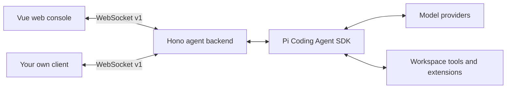

<div align="center">

# Pi Agent Gateway

**A web workspace for Pi Coding Agent. An agent backend for your own app.**

Manage conversations, models, Skills, MCP, and subagents in the browser — or connect your own client to the same backend.

[English](./README.md) · [简体中文](./README.zh-CN.md)

[](#quick-start)
[](./package.json)
[](./LICENSE)

[Quick start](#quick-start) · [Features](#features) · [Use your own frontend](#use-your-own-frontend) · [Contributing](./CONTRIBUTING.md)

</div>


*Actual console with a fresh configuration. The current UI is in Chinese; no model conversation is shown.*

## Why Pi Agent Gateway?

Pi Agent Gateway gives Pi a browser interface and exposes its session workflow through a typed WebSocket protocol. Use the included Vue console for local coding tasks, or use the Hono backend as the starting point for an agent feature in your own application.

- **Work visually:** follow streaming replies, reasoning output, and tool execution in one conversation.
- **Plan, then build:** switch between planning and implementation while keeping the same conversation history.
- **Bring your own interface:** the backend and frontend are separate workspaces, with their message contract in [`shared/types.ts`](./shared/types.ts).

Built on `@earendil-works/pi-coding-agent`. This is an independent project, not an official Pi product.

## Features

| Capability | What you can do |
| --- | --- |
| Conversations | Create and switch sessions; restore saved Pi JSONL conversations |
| Live execution | Read reasoning as it streams; it collapses when answer text starts and can be reopened |
| Projects | Browse directories and switch recent projects without restarting; always see the active directory |
| Run review | Inspect file diffs and root-session Bash commands/results from the latest task |
| Plan / Build | Change the primary agent in an idle session without losing history or model selection |
| Permissions | Routine Build operations run automatically; approve sensitive access once or by a visible session scope |
| Models | Authenticate built-in providers or configure compatible endpoints; discover models and test connections |
| Extensions | Manage Skills, plugins, subagent profiles, and MCP configuration from Settings |
| Custom clients | Consume versioned, session-scoped events over `/ws` |
| Appearance | Switch between light and dark themes |

<details>
<summary>See the model and extension settings</summary>


*Actual settings screen with a fresh configuration. Provider availability depends on the Pi runtime and your configuration.*

</details>

## Quick start

You need **Git**, **Node.js 22.19+**, **pnpm 10.22.0** (the pinned version), and access to a model provider. Model requests use your own provider credentials and may incur provider charges.

### 1. Clone and start

```sh
git clone https://github.com/Fucheng-Wu/pi-agent-gateway.git
cd pi-agent-gateway
pnpm install
pnpm dev
```

Open **<http://127.0.0.1:5173>**. The frontend proxies `/ws` and `/api` to the backend on `127.0.0.1:3000`.

### 2. Connect a model

If you already use Pi, the backend reads the default `~/.pi/agent/` configuration.

Otherwise, open **Settings (`设置`) → Models (`模型`) → Add Provider (`添加 Provider`)**:

1. Select a built-in provider and complete its authentication, or add a custom compatible endpoint.
2. For a custom endpoint, set the API type, Base URL, API Key, and model ID. Use model discovery if the provider supports it.
3. Save custom model configuration, create a conversation, and choose your model in the composer.

### 3. Point Pi at your project

Click the project directory in the sidebar, browse folders or enter an **absolute** path, and choose **使用此项目**. Recent projects are saved. Switching is blocked while tasks, settings operations, or login flows are running. All windows connected to the same backend share its active project.

You can also select the startup project through an environment variable:

**PowerShell**

```powershell
$env:PI_WORKSPACE_DIR = 'C:\path\to\your\project'
pnpm dev
```

**macOS / Linux shell**

```sh
PI_WORKSPACE_DIR=/absolute/path/to/your/project pnpm dev
```

Startup uses `PI_WORKSPACE_DIR`, then the last selected project, then the Gateway repository root. The home screen guides you through choosing a project and configuring a model.

### 4. Try a first task

Create a conversation, choose **Plan**, and ask:

> Read this project's entry points and explain its architecture. Propose a small improvement and an implementation plan.

When the session is idle, switch to **Build** to implement the agreed change. Build asks for confirmation before file changes, commands, and other operations that its policy does not allow automatically. `Tab` / `Shift+Tab` in the composer cycles primary agents.

See [configuration and troubleshooting](./docs/configuration.md) for environment variables, storage, and connection problems.

## Use your own frontend

The Vue console is one client of the backend. You can run the backend alone:

```sh
pnpm --filter ./backend dev
```

Your client connects to `ws://127.0.0.1:3000/ws`, completes the v1 handshake, and receives the session, model, provider, and settings catalogs. Every execution event includes a `sessionId` so clients can route concurrent output.



Start with the [TypeScript client](./client/README.md), [protocol guide](./docs/protocol.md), and [shared contract](./shared/types.ts). The client handles handshake, timeouts, reconnects, session refresh, and permission callbacks. After building, run `pnpm example:client` for a read-only integration example. The client package has not been published to npm.

## Current scope

- Designed for trusted local use. The backend binds to `127.0.0.1` by default and does not provide user authentication or tenant isolation. Add access control and workspace restrictions before enabling remote access.
- Permission rules are application-level checks, not an operating-system sandbox. Only install extensions you trust.
- Up to **5 AgentSession instances** remain active in memory; evicted conversations can be restored from their session files. This is not a user limit or a promise of five simultaneous tasks.
- Pi writes session files after the first assistant message. Empty conversations do not survive a backend restart.
- Subagent runs are currently one-shot and cannot be resumed. Resource changes reload idle sessions; busy sessions pick them up after a later reload or reopen.
- The web UI is currently in Chinese. Both English and Chinese README files are available.

## Development

```sh
pnpm typecheck
pnpm build
pnpm --filter ./backend test
pnpm test:frontend
```

`pnpm build` checks backend types and builds the web console and client package. Then `pnpm start` serves both the console and API at **<http://127.0.0.1:3000>**. The backend still runs from source using `tsx`. Backend tests use a local mock model provider and do not require a paid model key.

Long conversations initially render the latest 60 messages, with a control to load earlier messages. Streaming updates are frame-batched and tool output previews are bounded. The latest run review is saved with the session. File diffs require Git and compare against pre-task contents, including concurrent manual/other-session edits; binary, oversized, or omitted content is labeled. See [configuration](./docs/configuration.md) for limits and storage.

With a backend running, `pnpm smoke` checks the WebSocket handshake, catalogs, session lifecycle, and an authentication challenge. It creates and deletes a temporary empty session and cancels the challenge without saving credentials.

## Documentation and community

- [中文介绍与快速开始](./README.zh-CN.md)
- [Configuration and troubleshooting](./docs/configuration.md)
- [WebSocket integration](./docs/protocol.md)
- [Primary agents and permissions · 中文](./backend/primary-agents/README.md)
- [Custom subagents · 中文](./backend/subagents/README.md)
- [Project Skills · 中文](./backend/skills/README.md)
- [Contributing](./CONTRIBUTING.md) · [Report a bug](https://github.com/Fucheng-Wu/pi-agent-gateway/issues/new?template=bug_report.yml) · [Request a feature](https://github.com/Fucheng-Wu/pi-agent-gateway/issues/new?template=feature_request.yml)

Tried it in your own workflow? Share what you built or where you got stuck in an issue. If the project is useful to you, a star helps others discover it.

## License

[MIT](./LICENSE) © 2026 Fucheng Wu. Third-party dependencies retain their respective licenses.
