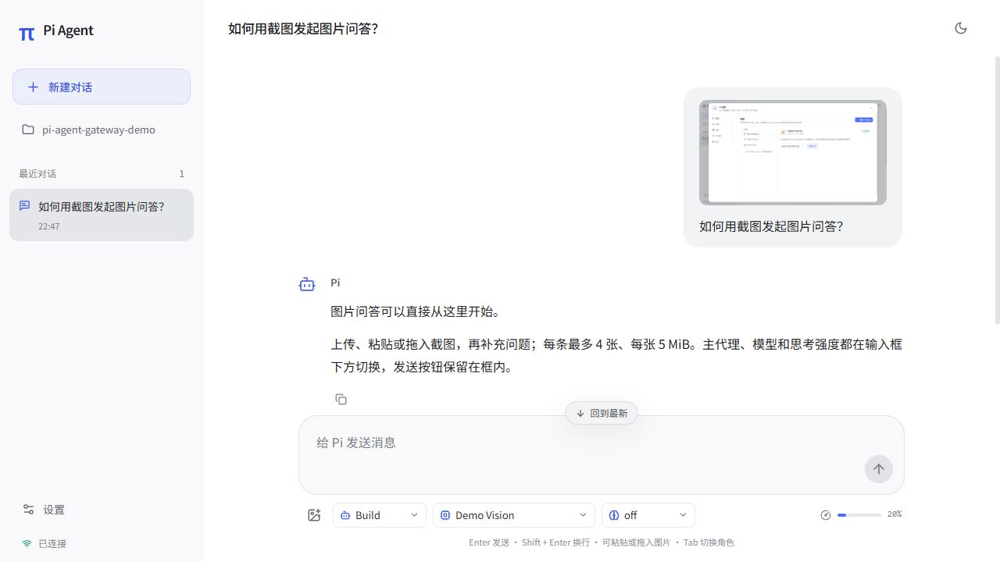
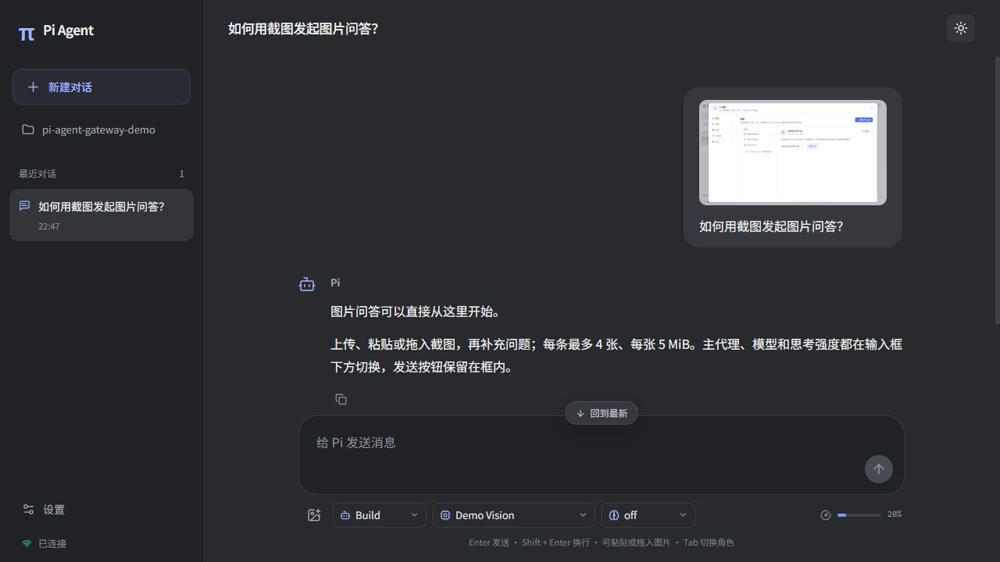
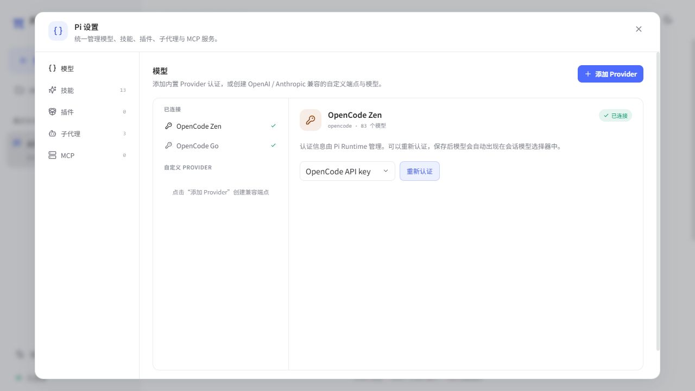
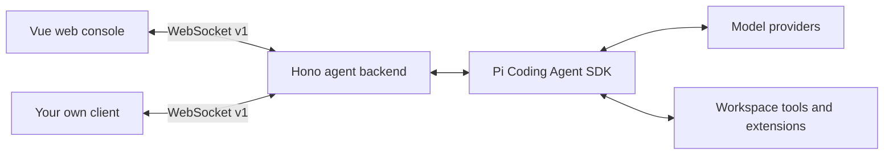

<div align="center">

# Pi Agent Gateway

**A web workspace for Pi Coding Agent. An agent backend for your own app.**

Choose a project, explore it in Plan, implement changes in Build, and inspect file diffs and command results. Or use the TypeScript client to bring the same workflow into your own app.

[English](./README.md) · [简体中文](./README.zh-CN.md)

[](#quick-start)
[](./package.json)
[](https://github.com/Fucheng-Wu/pi-agent-gateway/actions/workflows/ci.yml)
[](./LICENSE)

[Quick start](#quick-start) · [Features](#features) · [Use your own frontend](#use-your-own-frontend) · [Contributing](./CONTRIBUTING.md)

</div>



*The updated light-theme console, showing an isolated demo conversation, reasoning section, and tool card. Conversation content and tool results are simulated; no model was called.*

<details>
<summary>See the dark theme</summary>



*The same demo conversation in dark mode. The console starts in light mode and remembers your theme choice.*

</details>

## Why Pi Agent Gateway?

Pi Agent Gateway gives Pi a browser interface and exposes its session workflow through a typed WebSocket protocol. Use the included Vue console for local coding tasks, or use the Hono backend as the starting point for an agent feature in your own application.

- **Work visually:** follow streaming replies, reasoning output, and tool execution in one conversation.
- **Plan, then build:** switch between planning and implementation while keeping the same conversation history.
- **Review the result:** inspect file diffs, command output, and failures after each task.
- **Bring your own interface:** use the included Vue console, or integrate your frontend through the [TypeScript client](./client/README.md) and [WebSocket protocol](./docs/protocol.md).

Built on `@earendil-works/pi-coding-agent`. This is an independent project, not an official Pi product.

## Features

| Capability | What you can do |
| --- | --- |
| Conversations | Create and switch sessions; restore saved Pi JSONL conversations |
| Image questions | Upload, paste, or drop images; preview and remove attachments, send image-only prompts, and restore images from conversation history |
| Live execution | Read reasoning as it streams; it collapses when answer text starts and can be reopened |
| Projects | Browse directories and switch recent projects without restarting; see the project in the sidebar and hover for its full path |
| Run review | Inspect file diffs and root-session Bash commands/results from the latest task |
| Plan / Build | Change the primary agent in an idle session without losing history or model selection |
| Permissions | Routine Build operations run automatically; approve sensitive access once or by a visible session scope |
| Models | Authenticate built-in providers or configure compatible endpoints; discover models and test connections |
| Extensions | Manage Skills, plugins, subagent profiles, and MCP configuration from Settings |
| Recovery | Restore input state after failed or timed-out requests; refresh active and cached background sessions after reconnecting, using event sequences to handle duplicates and gaps |
| Custom clients | A typed client handles handshake, request correlation, deadlines, heartbeats, reconnects, session subscriptions, and permission callbacks |
| Reading and themes | Bundled Chinese typography, consistent Markdown headings/lists/code/tables, incremental history rendering, light/dark themes, and narrow-screen layouts |

<details>
<summary>See the model and extension settings</summary>



*The updated settings screen uses an isolated demo configuration without displaying credentials. Provider availability depends on the Pi runtime and your configuration.*

</details>

## Quick start

You need **Git**, **Node.js 22.19+**, **pnpm 10.22.0** (the pinned version), and access to a model provider. Model requests use your own provider credentials and may incur provider charges.

### 1. Clone and start

```sh
git clone https://github.com/Fucheng-Wu/pi-agent-gateway.git
cd pi-agent-gateway
pnpm install
pnpm build
pnpm start
```

Open **<http://127.0.0.1:3000>**. The same backend serves the console, `/api`, and `/ws`. After the first build, use `pnpm start` for subsequent launches; rebuild after updating the code.

For development, `pnpm dev` serves the frontend at **<http://127.0.0.1:5173>** and proxies backend requests. See [Development](#development) for checks and commands.

### 2. Connect a model

If you already use Pi, the backend reads the default `~/.pi/agent/` configuration.

Otherwise, open **Settings (`设置`) → Models (`模型`) → Add Provider (`添加 Provider`)**:

1. Select a built-in provider and complete its authentication, or add a custom compatible endpoint.
2. For a custom endpoint, set the API type, Base URL, API Key, and model ID. Use model discovery if the provider supports it.
3. Save custom model configuration, create a conversation, and choose your model in the composer.

### 3. Point Pi at your project

Click the project directory in the sidebar, browse folders or enter an **absolute** path, and choose **使用此项目**. Recent projects are saved. Switching is blocked while tasks, settings operations, or login flows are running. All windows connected to the same backend share its active project.

You can also select the startup project through an environment variable:

**PowerShell**

```powershell
$env:PI_WORKSPACE_DIR = 'C:\path\to\your\project'
pnpm start
```

**macOS / Linux shell**

```sh
PI_WORKSPACE_DIR=/absolute/path/to/your/project pnpm start
```

Startup uses `PI_WORKSPACE_DIR`, then the last selected project, then the Gateway repository root. The home screen guides you through choosing a project and configuring a model.

### 4. Try a first task

Create a conversation, choose **Plan**, and ask:

> Read this project's entry points and explain its architecture. Propose a small improvement and an implementation plan.

When the session is idle, switch to **Build** to implement the agreed change. Build runs routine file changes and commands automatically. File tools require approval for paths outside the workspace and sensitive `.env` reads. Approve once, approve the displayed scope for this session, or deny. `Tab` / `Shift+Tab` in the composer cycles primary agents.

### 5. Review results and continue

- Expand **本轮变更** (Run review) to inspect file diffs, root-session Bash commands, and their output. The latest report is restored with its session.
- Reopen **思考过程** (Reasoning) or tool cards to inspect execution details. Reasoning output depends on the model.
- Long conversations initially render the latest 60 messages, with a control to load earlier history. Tool output initially shows its last 12,000 characters and can be expanded.
- Failed or timed-out requests restore input state. Connections recover automatically and refresh sessions; check the current state before resending a request with an unknown outcome.

File diffs compare the workspace before and after the task, including concurrent manual or other-session edits. Git is required, and omitted files/content are labeled. See [run review limits](./docs/configuration.md#run-review-and-long-conversations).

See [configuration and troubleshooting](./docs/configuration.md) for environment variables, storage, and connection problems.

## Use your own frontend

The Vue console is one client of the backend. You can run the backend alone:

```sh
pnpm --filter ./backend dev
```

Your client connects to `ws://127.0.0.1:3000/ws`, completes the v1 handshake, and receives the session, model, provider, and settings catalogs. Every execution event includes a `sessionId` so clients can route concurrent output.



The repository includes a locally built **`@pi-agent-gateway/client`** package for browsers and Node.js 22+. With the backend running, use another terminal to run:

```sh
pnpm example:client
```

This [read-only example](./examples/client.mjs) prints the workspace and session/model counts without creating a task or calling a model. The client package has not been published to npm.

A `prompt` acknowledgement means accepted; `agent_end` signals completion. Custom interfaces must handle permission requests. Reconnection refreshes subscribed sessions, and mutating commands are never automatically replayed because they may already have executed.

Continue with the [client API and examples](./client/README.md), [protocol guide](./docs/protocol.md), and [shared TypeScript contract](./shared/types.ts).

## Configuration

| Environment variable | Default | Purpose |
| --- | --- | --- |
| `PI_WORKSPACE_DIR` | Last selected project, then the repository root | Startup project; change it in the console during use |
| `PI_AGENT_DIR` | `~/.pi/agent` | Models, authentication, settings, and saved sessions |
| `HOST` | `127.0.0.1` | Backend bind address |
| `PORT` | `3000` | Backend port; also read by the development proxy |

Recent projects are saved in `PI_AGENT_DIR/gateway.json`; latest session reports are stored in `gateway-reviews/`. Skills, primary agents, subagents, and MCP retain their documented resource discovery rules. See [configuration and troubleshooting](./docs/configuration.md) for all storage locations and examples.

## Current scope

- Designed for trusted local use. The backend binds to `127.0.0.1` by default and does not provide user authentication or tenant isolation. Add access control and workspace restrictions before enabling remote access.
- Permission rules are application-level checks, not an operating-system sandbox. Only install extensions you trust.
- Up to **5 AgentSession instances** remain active in memory; evicted conversations can be restored from their session files. This is not a user limit or a promise of five simultaneous tasks.
- Pi writes session files after the first assistant message. Empty conversations do not survive a backend restart.
- Subagent runs are currently one-shot and cannot be resumed. Resource changes reload idle sessions; busy sessions pick them up after a later reload or reopen.
- The web UI is currently in Chinese. Both English and Chinese README files are available.

## Development

```sh
pnpm typecheck
pnpm build
pnpm test
```

`pnpm build` checks backend types and builds the web console and client package. Then `pnpm start` serves both the console and API at **<http://127.0.0.1:3000>**. The backend still runs from source using `tsx`. Backend tests use a local mock model provider and do not require a paid model key.

`pnpm test` runs backend and frontend tests in sequence. Run them individually with `pnpm --filter ./backend test` or `pnpm test:frontend`. CI checks types, builds, and runs tests on Windows and Linux.

Use `pnpm dev` for frontend development at `http://127.0.0.1:5173`. Chinese fonts are bundled with the application and loaded by glyph subset, without a runtime dependency on an external font service. See the [Noto Sans SC OFL license](./frontend/public/fonts/noto-sans-sc-LICENSE.txt).

With a backend running, `pnpm smoke` checks the WebSocket handshake, catalogs, session lifecycle, and an authentication challenge. It creates and deletes a temporary empty session and cancels the challenge without saving credentials.

## Documentation and community

- [中文介绍与快速开始](./README.zh-CN.md)
- [Configuration and troubleshooting](./docs/configuration.md)
- [WebSocket integration](./docs/protocol.md)
- [Primary agents and permissions · 中文](./backend/primary-agents/README.md)
- [Custom subagents · 中文](./backend/subagents/README.md)
- [Project Skills · 中文](./backend/skills/README.md)
- [Contributing](./CONTRIBUTING.md) · [Report a bug](https://github.com/Fucheng-Wu/pi-agent-gateway/issues/new?template=bug_report.yml) · [Request a feature](https://github.com/Fucheng-Wu/pi-agent-gateway/issues/new?template=feature_request.yml)

Tried it in your own workflow? Share what you built or where you got stuck in an issue. If the project is useful to you, a star helps others discover it.

## License

[MIT](./LICENSE) © 2026 Fucheng Wu. Third-party dependencies retain their respective licenses.
