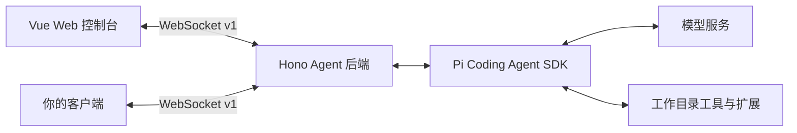

<div align="center">

# Pi Agent Gateway

**给 Pi Coding Agent 一个可视化工作台，并把 Agent 后端接入你自己的应用。**

在浏览器中管理对话、模型、Skills、MCP 和子代理，也可以使用独立后端构建自己的客户端。

[English](./README.md) · [简体中文](./README.zh-CN.md)

[](#快速开始)
[](./package.json)
[](./LICENSE)

[快速开始](#快速开始) · [功能](#功能) · [接入自己的应用](#接入自己的应用) · [参与贡献](./CONTRIBUTING.md)

</div>


*使用全新配置截取的真实界面，尚未进行模型对话。*

## 为什么做这个项目？

Pi Agent Gateway 为 Pi 提供浏览器工作台，并通过有类型定义的 WebSocket 协议暴露会话流程。你可以直接用 Vue 控制台处理本地编程任务，也可以以 Hono 后端为起点，为自己的应用加入 Agent 能力。

- **看得见执行过程**：在同一个对话里查看流式回复、模型提供的思维过程、工具输入与执行结果。
- **先规划，再实现**：在 Plan 和 Build 之间切换，保留同一份会话历史。
- **界面由你决定**：前后端是独立工作区，通过 [`shared/types.ts`](./shared/types.ts) 中的协议通信。

基于 `@earendil-works/pi-coding-agent` 构建。这是独立项目，并非 Pi 官方产品。

## 功能

| 能力 | 你可以做什么 |
| --- | --- |
| 多会话 | 创建、切换对话，从 Pi JSONL 文件恢复已保存的历史 |
| 实时执行 | 思考内容生成时自动展开、正文输出时折叠，可手动回看；查看工具输入与结果 |
| Plan / Build | 在会话空闲时切换主代理，保留历史、模型及思考强度 |
| 权限确认 | Build 常规操作自动执行；敏感访问可本次允许、按展示范围本会话允许或拒绝 |
| 模型管理 | 认证内置 Provider，配置兼容端点，发现模型并测试连接 |
| 扩展管理 | 在设置中管理 Skills、插件、子代理及 MCP 配置 |
| 自定义客户端 | 通过 `/ws` 接收带版本、按会话区分的消息与事件 |
| 主题 | 切换亮色与暗色界面 |

<details>
<summary>查看模型与扩展设置界面</summary>


*使用全新配置截取的真实设置页。可用 Provider 取决于 Pi 运行时和你的配置。*

</details>

## 快速开始

需要 **Git**、**Node.js 22.19+**、**pnpm 10.22.0**（仓库固定版本），以及可用的模型服务。模型请求使用你自己的 Provider 凭证，可能产生上游服务费用。

### 1. 克隆并启动

```sh
git clone https://github.com/Fucheng-Wu/pi-agent-gateway.git
cd pi-agent-gateway
pnpm install
pnpm dev
```

打开 **<http://127.0.0.1:5173>**。前端会将 `/ws` 和 `/api` 转发至后端 `127.0.0.1:3000`。

### 2. 配置模型

如果已使用 Pi，后端默认读取 `~/.pi/agent/` 中的配置。

首次使用时，打开 **设置 → 模型 → 添加 Provider**：

1. 选择内置 Provider 完成认证，或创建自定义兼容端点。
2. 自定义端点需要填写 API 类型、Base URL、API Key 和模型 ID；上游支持时，也可以发现模型。
3. 保存自定义模型配置，创建对话，在输入框底部选择模型。

### 3. 指定要操作的项目

停止开发服务，设置项目的**绝对路径**后重新启动。

**PowerShell**

```powershell
$env:PI_WORKSPACE_DIR = 'C:\path\to\your\project'
pnpm dev
```

**macOS / Linux shell**

```sh
PI_WORKSPACE_DIR=/absolute/path/to/your/project pnpm dev
```

如果不设置，从根目录执行 `pnpm dev` 时，Pi 的工作目录是 `backend/`。

### 4. 完成第一个任务

新建对话，选择 **Plan**，发送：

> 阅读这个项目的入口文件，解释整体架构，找出一个适合改进的小问题，并给出实现计划。

会话空闲后，切换到 **Build** 实现确认过的方案。Build 默认对文件修改、命令执行及其他未明确允许的操作请求确认。在输入框按 `Tab` / `Shift+Tab` 可以循环切换主代理。

环境变量、数据存储和连接问题见 [配置与排查文档（英文）](./docs/configuration.md)。

## 接入自己的应用

Vue 控制台是后端的一套客户端。也可以只启动后端：

```sh
pnpm --filter ./backend dev
```

你的客户端连接 `ws://127.0.0.1:3000/ws`，完成 v1 握手后，即可获取会话、模型、Provider 和设置目录。运行事件都携带 `sessionId`，可据此分流多个会话的实时输出。



从 [协议指南（英文）](./docs/protocol.md)、[TypeScript 消息定义](./shared/types.ts) 和现有的 [WebSocket 冒烟客户端](./scripts/smoke.mjs) 开始。当前后端从源码运行，尚未作为独立 SDK 包发布。

## 配置速查

| 环境变量 | 默认值 | 用途 |
| --- | --- | --- |
| `PI_WORKSPACE_DIR` | 后端启动时的工作目录 | Pi 的文件与终端工具所操作的项目 |
| `PI_AGENT_DIR` | `~/.pi/agent` | 模型、认证、设置和会话数据目录 |
| `HOST` | `127.0.0.1` | 后端监听地址 |
| `PORT` | `3000` | 后端端口；开发前端代理也会读取此值 |

设置中保存的配置接入 Pi 原生资源加载与扩展运行时：

- 模型、认证与设置：`PI_AGENT_DIR` 下的 `models.json`、`auth.json`、`settings.json`。
- 项目技能：[`backend/skills`](./backend/skills/README.md)，同时保留 Pi 原有的全局和项目发现规则。
- 主代理：[`backend/primary-agents`](./backend/primary-agents/README.md)，可自定义角色、工具白名单和权限。
- 子代理：[`backend/subagents`](./backend/subagents/README.md)，支持提示词、工具、技能白名单和专属 TypeScript 扩展；全局角色兼容 `~/.pi/agent/agents/`。
- MCP：`PI_AGENT_DIR` 下的 `mcp.json`。

## 当前边界

- 面向可信本地使用，默认只监听 `127.0.0.1`。当前没有用户身份验证或租户隔离；远程访问前应增加访问控制并限制可操作的工作目录。
- 权限规则属于应用层检查，不是操作系统沙箱。只安装可信扩展。
- 内存中最多保留 **5 个活跃 AgentSession**，被淘汰的会话可从文件恢复；这不是用户数量限制，也不代表承诺同时执行五个任务。
- 首次产生助手消息后才会写出会话文件，空对话不会在后端重启后保留。
- 子代理为一次性执行，暂不支持续跑。资源设置保存后自动重载空闲会话，忙碌会话在后续重载或重新打开后生效。
- 当前 Web 界面使用中文，README 提供中英两个版本。

## 开发与检查

```sh
pnpm typecheck
pnpm build
pnpm --filter ./backend test
pnpm test:frontend
```

`pnpm build` 检查后端类型并生成前端静态构建，不会产出前后端合一的生产服务器。后端测试使用本地模拟模型服务，无需付费模型密钥。

后端运行后，可执行 `pnpm smoke` 检查 WebSocket 握手、目录、会话生命周期和认证挑战。它会创建并删除一个测试空会话，并取消认证挑战，不保存凭证。

## 参与项目

欢迎使用中文或英文 [报告问题](https://github.com/Fucheng-Wu/pi-agent-gateway/issues/new?template=bug_report.yml)、[提出功能建议](https://github.com/Fucheng-Wu/pi-agent-gateway/issues/new?template=feature_request.yml)，或提交 Pull Request。参见 [贡献指南](./CONTRIBUTING.md)。

如果接入了自己的项目，欢迎在 Issue 分享使用场景与遇到的问题。如果这个项目对你有帮助，也欢迎点一个 Star，让更多人发现它。

## 许可证

[MIT](./LICENSE) © 2026 Fucheng Wu。第三方依赖保留各自的许可证。
