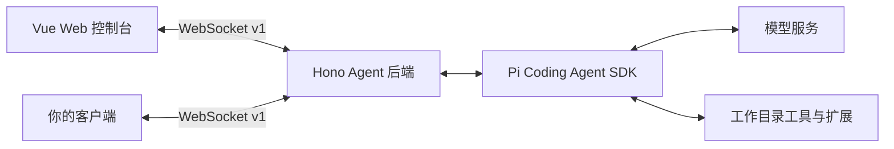

<div align="center">

# Pi Agent Gateway

**给 Pi Coding Agent 一个可视化工作台，并把 Agent 后端接入你自己的应用。**

选择项目，用 Plan 理清思路、用 Build 实施修改，再检查文件 diff 和执行结果。上传截图讨论界面或报错，在主对话旁查看子代理的执行过程。也可以通过 TypeScript 客户端把这套能力接入自己的应用。

[English](./README.md) · [简体中文](./README.zh-CN.md)

[](#快速开始)
[](./package.json)
[](https://github.com/Fucheng-Wu/pi-agent-gateway/actions/workflows/ci.yml)
[](./LICENSE)

[快速开始](#快速开始) · [功能](#功能) · [图片问答](#图片问答) · [接入自己的应用](#接入自己的应用) · [参与贡献](./CONTRIBUTING.md)

</div>


*隔离演示环境中的亮色控制台：展示图片问答、附件预览，以及输入框下方的对话工具栏。回复由本地测试服务模拟。*

<details>
<summary>查看暗色界面</summary>


*同一演示会话的暗色界面。默认使用亮色主题，并记住你的主题选择。*

</details>

## 为什么做这个项目？

Pi Agent Gateway 为 Pi 提供浏览器工作台，并通过有类型定义的 WebSocket 协议暴露会话流程。你可以直接用 Vue 控制台处理本地编程任务，也可以以 Hono 后端为起点，为自己的应用加入 Agent 能力。

- **看得见执行过程**：在同一个对话里查看流式回复、模型提供的思维过程、工具输入与执行结果。
- **带着图片提问**：附上截图，用支持图像输入的模型讨论界面、报错或图表。
- **先规划，再实现**：在 Plan 和 Build 之间切换，保留同一份会话历史。
- **检查实际结果**：任务结束后查看本轮文件 diff、命令输出和失败情况。
- **界面由你决定**：使用附带的 Vue 控制台，或通过 [TypeScript 客户端](./client/README.md) 和 [WebSocket 协议](./docs/protocol.md) 接入自己的前端。

基于 `@earendil-works/pi-coding-agent` 构建。这是独立项目，并非 Pi 官方产品。

## 功能

| 能力 | 你可以做什么 |
| --- | --- |
| 多会话 | 创建、切换对话，从 Pi JSONL 文件恢复已保存的历史 |
| 图片问答 | 点击上传、粘贴或拖入图片，预览和移除附件，支持仅图片提问；历史会话保留图片 |
| 输入区 | 框内保留发送/停止按钮；上传图片、主代理、模型、思考强度和上下文用量位于框下方 |
| 子代理协作 | 后台并行执行、发送消息、追加任务、等待、中断与继续；在主对话旁查看消息、思考和工具执行，历史随主会话保存 |
| 项目选择 | 浏览目录、切换最近项目，无需重启；侧栏显示当前项目，悬停查看完整路径 |
| 本轮变更 | 查看任务期间的文件 diff、根会话执行的 Bash 命令及结果 |
| 实时执行 | 思考内容生成时自动展开、正文输出时折叠，可手动回看；查看工具输入与结果 |
| Plan / Build | 在会话空闲时切换主代理，保留历史、模型及思考强度 |
| 权限确认 | Build 常规操作自动执行；敏感访问可本次允许、按展示范围本会话允许或拒绝 |
| 模型管理 | 认证内置 Provider，配置兼容端点，发现模型并测试连接 |
| 扩展管理 | 在设置中管理 Skills、插件、子代理及 MCP 配置 |
| 会话恢复 | 请求失败或超时后恢复输入状态；重连时同步前台和已缓存的后台会话，使用事件序号处理重复和缺失 |
| 自定义客户端 | TypeScript 客户端封装握手、请求关联、超时、心跳、重连、会话订阅和权限回调 |
| 阅读与主题 | 内置中文字体，统一 Markdown 标题、列表、代码和表格；长对话分批展示，支持亮暗主题与窄屏布局 |

<details>
<summary>查看模型与扩展设置界面</summary>


*新版真实设置页，使用隔离的演示配置，未展示凭证。可用 Provider 取决于 Pi 运行时和你的配置。*

</details>

## 快速开始

需要 **Git**、**Node.js 22.19+**、**pnpm 10.22.0**（仓库固定版本），以及可用的模型服务。模型请求使用你自己的 Provider 凭证，可能产生上游服务费用。

### 1. 克隆并启动

```sh
git clone https://github.com/Fucheng-Wu/pi-agent-gateway.git
cd pi-agent-gateway
pnpm install
pnpm build
pnpm start
```

打开 **<http://127.0.0.1:3000>**，同一个后端同时提供控制台、`/api` 和 `/ws`。首次构建后，后续启动运行 `pnpm start` 即可；更新代码后重新构建。

需要修改代码时使用 `pnpm dev`，开发界面位于 **<http://127.0.0.1:5173>**，自动代理后端请求。完整命令见 [开发与检查](#开发与检查)。

### 2. 配置模型

如果已使用 Pi，后端默认读取 `~/.pi/agent/` 中的配置。

首次使用时，打开 **设置 → 模型 → 添加 Provider**：

1. 选择内置 Provider 完成认证，或创建自定义兼容端点。
2. 自定义端点需要填写 API 类型、Base URL、API Key 和模型 ID；上游支持时，也可以发现模型。
3. 保存自定义模型配置，创建对话，在**输入框下方的工具栏**选择模型。

新建会话读取 Pi 的 `settings.json` 中的默认模型。以 DeepSeek Flash 为例，将以下字段合并到 `PI_AGENT_DIR/settings.json`（通常是 `~/.pi/agent/settings.json`），保留其他已有配置：

```json
{
  "defaultProvider": "deepseek",
  "defaultModel": "deepseek-flash"
}
```

需先完成 Provider 认证，并确认模型 ID 存在于可用目录中。已有会话保留原来的模型选择；在单个会话切换模型不会修改全局默认值。

### 3. 指定要操作的项目

点击侧栏的项目目录，浏览文件夹或输入**绝对路径**，选择“使用此项目”。最近项目会保存，任务、设置操作或登录执行中不能切换。所有连接到同一后端的窗口共享当前项目。

也可以在启动时通过环境变量指定目录：

**PowerShell**

```powershell
$env:PI_WORKSPACE_DIR = 'C:\path\to\your\project'
pnpm start
```

**macOS / Linux shell**

```sh
PI_WORKSPACE_DIR=/absolute/path/to/your/project pnpm start
```

启动目录优先级为 `PI_WORKSPACE_DIR`、上次选择的项目、Gateway 仓库根目录。首页提供项目和模型配置引导。

### 4. 完成第一个任务

新建对话，选择 **Plan**，发送：

> 阅读这个项目的入口文件，解释整体架构，找出一个适合改进的小问题，并给出实现计划。

输入框下方依次提供图片上传、主代理、模型、思考强度和上下文用量。框内仅保留发送按钮，生成时切换为停止按钮；图片预览位于框上方。按 `Enter` 发送，`Shift+Enter` 换行。

会话空闲后，切换到 **Build** 实现确认过的方案。Build 默认自动执行常规文件修改和命令；文件工具访问工作目录外的路径或读取敏感 `.env` 时需要确认。确认框支持本次允许、按展示范围本会话允许或拒绝。在输入框按 `Tab` / `Shift+Tab` 可以循环切换主代理。

### 5. 检查结果与继续对话

- 展开 **本轮变更**，检查文件 diff、根会话 Bash 命令及其输出。最近一轮报告会随会话恢复。
- 展开 **思考过程** 或工具卡片回看执行细节；是否有思考输出取决于模型。
- 长对话首先展示最近 60 条消息，可点击加载更早消息；工具输出默认展示末尾 12,000 个字符，可手动展开。
- 发送失败或超时后界面会恢复输入状态；断线后自动重连并重新同步会话。结果未确认时，先检查会话状态再决定是否重新发送。

文件 diff 比较的是本轮任务开始前后的工作区内容，也会包含同期手动或其他会话的修改。它需要 Git，省略的文件和内容会在界面中提示，详见 [变更报告与限制](./docs/configuration.md#run-review-and-long-conversations)。

环境变量、数据存储和连接问题见 [配置与排查文档（英文）](./docs/configuration.md)。

## 图片问答

1. 在输入框下方的模型选择器中，选择带 **图像** 标记的模型。
2. 点击同一工具栏中的上传按钮，或向输入框粘贴图片、拖入图片文件。在输入框上方预览附件，并移除不需要的图片。
3. 输入问题，例如“这张报错截图是什么意思？”，也可以不填写文字，直接发送图片。

支持 **PNG、JPEG、GIF、WebP**，每条消息最多 **4 张**，每张不超过 **5 MiB**。发送前会检查格式、大小和图片能否解码。选用纯文本模型时，界面会提示切换，并禁用图片发送。

自定义视觉模型需在设置中将输入类型配置为 `text, image`，且上游模型实际支持图像输入。Pi 可能按 Provider 限制调整图片尺寸。图片会随 Pi JSONL 会话历史保存，重新打开对话后仍可查看；请求被拒绝时，已提交的文字和图片会恢复为草稿。

自定义客户端可在 `prompt` 命令的 `text` 之外传入 `images`，详见 [图片消息格式与限制](./docs/protocol.md#3-send-a-task-and-consume-events)。

## 接入自己的应用

Vue 控制台是后端的一套客户端。也可以只启动后端：

```sh
pnpm --filter ./backend dev
```

你的客户端连接 `ws://127.0.0.1:3000/ws`，完成 v1 握手后，即可获取会话、模型、Provider 和设置目录。运行事件都携带 `sessionId`，可据此分流多个会话的实时输出。



仓库提供本地构建的 **`@pi-agent-gateway/client`**，支持浏览器和 Node.js 22+。后端运行时，在另一个终端执行：

```sh
pnpm example:client
```

这个 [只读示例](./examples/client.mjs) 会输出当前项目、会话数和模型数，不创建任务或调用模型。客户端尚未发布到 npm。

接入时，`prompt` 的确认响应表示任务已接受，`agent_end` 才表示本轮结束；自定义界面需要处理权限请求。断线重连会刷新订阅会话，客户端不会自动重发可能已执行的修改请求。

从 [客户端 API 与示例](./client/README.md)、[完整协议指南](./docs/protocol.md) 和 [TypeScript 消息定义](./shared/types.ts) 继续。

## 配置速查

| 环境变量 | 默认值 | 用途 |
| --- | --- | --- |
| `PI_WORKSPACE_DIR` | 上次选择的项目，首次为仓库根目录 | 启动时选择 Pi 操作的项目，运行中可在界面切换 |
| `PI_AGENT_DIR` | `~/.pi/agent` | 模型、认证、设置和会话数据目录 |
| `HOST` | `127.0.0.1` | 后端监听地址 |
| `PORT` | `3000` | 后端端口；开发前端代理也会读取此值 |

设置中保存的配置接入 Pi 原生资源加载与扩展运行时：

- 模型、认证与设置：`PI_AGENT_DIR` 下的 `models.json`、`auth.json`、`settings.json`。
- 最近项目与会话报告：`PI_AGENT_DIR` 下的 `gateway.json`、`gateway-reviews/`。
- 项目技能：[`backend/skills`](./backend/skills/README.md)，同时保留 Pi 原有的全局和项目发现规则。
- 主代理：[`backend/primary-agents`](./backend/primary-agents/README.md)，可自定义角色、工具白名单和权限。
- 子代理：[`backend/subagents`](./backend/subagents/README.md)，支持提示词、工具、技能白名单和专属 TypeScript 扩展；全局角色兼容 `~/.pi/agent/agents/`。
- MCP：`PI_AGENT_DIR` 下的 `mcp.json`。

## 当前边界

- 面向可信本地使用，默认只监听 `127.0.0.1`。当前没有用户身份验证或租户隔离；远程访问前应增加访问控制并限制可操作的工作目录。
- 权限规则属于应用层检查，不是操作系统沙箱。只安装可信扩展。
- 内存中最多保留 **5 个活跃 AgentSession**，被淘汰的会话可从文件恢复；这不是用户数量限制，也不代表承诺同时执行五个任务。
- 首次产生助手消息后才会写出会话文件，空对话不会在后端重启后保留。
- 协作子代理在内存子会话存续期间支持追加任务和中断后继续；后端重启、会话淘汰、切换主代理、资源重载或项目切换会释放子会话，保留历史。原来的 `Agent` 工具仍为一次性执行。详见[协作工具与生命周期](./backend/subagents/README.md)。
- 当前 Web 界面使用中文，README 提供中英两个版本。

## 开发与检查

```sh
pnpm typecheck
pnpm build
pnpm test
```

`pnpm build` 检查后端类型、生成前端静态文件和客户端包；然后运行 `pnpm start`，从 **<http://127.0.0.1:3000>** 同时访问控制台和后端。后端仍通过 `tsx` 从源码运行。后端测试使用本地模拟模型服务，无需付费模型密钥。

`pnpm test` 依次执行后端和前端测试；也可分别运行 `pnpm --filter ./backend test`、`pnpm test:frontend`。CI 在 Windows 和 Linux 上运行类型检查、构建和测试。

前端开发运行 `pnpm dev`，访问 `http://127.0.0.1:5173`。中文字体随应用构建，按字形子集加载，不依赖运行时的外部字体服务；字体许可证见 [Noto Sans SC OFL](./frontend/public/fonts/noto-sans-sc-LICENSE.txt)。

后端运行后，可执行 `pnpm smoke` 检查 WebSocket 握手、目录、会话生命周期和认证挑战。它会创建并删除一个测试空会话，并取消认证挑战，不保存凭证。

## 参与项目

欢迎使用中文或英文 [报告问题](https://github.com/Fucheng-Wu/pi-agent-gateway/issues/new?template=bug_report.yml)、[提出功能建议](https://github.com/Fucheng-Wu/pi-agent-gateway/issues/new?template=feature_request.yml)，或提交 Pull Request。参见 [贡献指南](./CONTRIBUTING.md)。

如果接入了自己的项目，欢迎在 Issue 分享使用场景与遇到的问题。如果这个项目对你有帮助，也欢迎点一个 Star，让更多人发现它。

## 许可证

[MIT](./LICENSE) © 2026 Fucheng Wu。第三方依赖保留各自的许可证。
